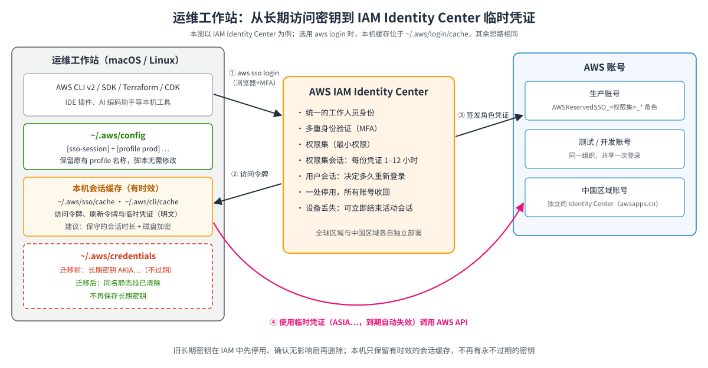

# 让电脑里"无钥可偷"：用 aws login 或 IAM Identity Center 告别 AWS CLI 长期访问密钥

先做个小实验。打开终端，执行：

```bash
$ grep -o 'AKIA' ~/.aws/credentials ~/.aws/config 2>/dev/null | wc -l
```

结果大于 0，说明你的电脑里存着**永不过期的亚马逊云科技访问密钥**。只要没人到 IAM 里停用它们，它们就一直有效，而本机的 IDE 插件、AI 编码助手、依赖包安装脚本都能读到这个文件。

本文按你**现在的情况**给出两条官方路径，目标相同：**不改动现有脚本**（profile 名称不变），把本机的长期访问密钥换成自动过期的临时凭证，再在 IAM 中停用并删除旧密钥。

> **适合读者**：使用 AWS CLI 的运维、平台工程师和开发者（Level 200–300）。本文不涉及如何开通 IAM Identity Center。不想自己敲命令的，可以跳到「[让 Kiro 替你完成迁移](#让-kiro-替你完成迁移)」。

---

## 选择你的路径

```text
你能打开 AWS access portal（形如 https://d-xxxxxxxxxx.awsapps.com/start），并看到要用的账号吗？
├── 能   → 路径 B：IAM Identity Center（sso-session，AWS CLI 2.9.0+）
└── 不能 → 你能用 IAM 用户或企业 IdP 联合身份登录控制台吗？
          ├── 能       → 路径 A：aws login（AWS CLI 2.32.0+）
          └── 只有 root → 技术上可用 aws login，但不建议日常使用 root，
                          请管理员为你创建 IAM 用户或联合角色
```

| 对比 | 路径 A：`aws login` | 路径 B：IAM Identity Center（`sso-session`） |
|---|---|---|
| 登录身份 | 各账号的 IAM 用户，或经 IAM 联合的角色 | IAM Identity Center 中统一管理的身份 |
| 多账号 | 每个 profile 分别登录 | 一次登录，覆盖所有已分配的账号 |
| 额外准备 | 登录身份需附加托管策略 `SignInLocalDevelopmentAccess` | 无，账号和权限集由管理员分配 |
| 会话 | 每 15 分钟自动刷新，最长为 IAM 主体的会话时长（上限 12 小时） | 由权限集会话时长和用户会话时长决定 |

两条路径可以在同一台电脑上混用，每个 profile 只认自己的配置。

### 前提条件

**路径 A：aws login（用 IAM 用户或 IAM 联合角色，不用 IAM Identity Center）**

1. 本机 AWS CLI 版本 2.32.0 或以上（`aws --version` 查看）。
2. 你能用以下身份之一登录要迁移的那个账号的控制台：该账号中的 **IAM 用户**，或通过企业 IdP 直接联合到该账号的 **IAM 角色**。已经在用 IAM Identity Center 门户的，请走路径 B。
3. 这个 IAM 用户、它所在的用户组或联合角色上附加了托管策略 `SignInLocalDevelopmentAccess`。
4. 本机有浏览器；没有浏览器时，需要另一台能打开网页的设备（配合 `--remote`）。

**路径 B：IAM Identity Center（用 Identity Center 用户，不用 IAM 用户）**

1. 本机 AWS CLI 版本 2.9.0 或以上。
2. 组织已开通 IAM Identity Center，你有 Identity Center 用户，并能登录 access portal。
3. 管理员已经把要用的账号和权限集分配给你，门户里能看到这些账号。
4. 从门户任一账号的 *Access keys* 页面拿到 **SSO Start URL** 和 **SSO Region**。

**两条路径通用**：步骤 5 停用、删除旧密钥时，需要 `iam:ListAccessKeys`、`iam:GetAccessKeyLastUsed`、`iam:UpdateAccessKey`、`iam:DeleteAccessKey` 权限。路径 A 是对自己这个 IAM 用户的权限；路径 B 的权限集需要能操作旧密钥所属的 IAM 用户。

### 先弄清两个文件：config 和 credentials

AWS CLI 从两个文件读取 profile，两者分工不同：

| 文件 | 存什么 | 段名写法 | 本文中谁来改 |
|---|---|---|---|
| `~/.aws/config` | profile 的设置：区域、输出格式、`login_session`、`sso_session` 等登录方式 | `[default]`、`[profile dev]`、`[sso-session main-sso]` | **两条路径都由 CLI 自动写入，无需手动编辑**：路径 A 由 `aws login` 写入；路径 B 由 `aws configure sso` 向导写入（账号很多时也可用步骤 2 的可选脚本批量合并） |
| `~/.aws/credentials` | 静态访问密钥：`aws_access_key_id`（`AKIA` 开头）和 `aws_secret_access_key` | `[default]`、`[dev]`（不带 `profile` 前缀） | **只删不加**：两条路径都要在步骤 3 删除迁移 profile 的同名段 |

迁移前后，文件里的内容会这样变化（以 `default` profile 为例）：

```ini
# 迁移前 ~/.aws/credentials：长期密钥明文
[default]
aws_access_key_id = AKIA****************
aws_secret_access_key = ****************************************

# 迁移后 ~/.aws/credentials：[default] 段已删除，文件可以为空

# 迁移后 ~/.aws/config（路径 A，由 aws login 自动写入，不含任何密钥）
[default]
login_session = arn:aws:iam::444444444444:user/alice
region = us-east-1

# 迁移后 ~/.aws/config（路径 B，由 aws configure sso 向导自动写入，不含任何密钥）
[sso-session main-sso]
sso_start_url = https://d-1234567890.awsapps.com/start
sso_region = us-east-1
sso_registration_scopes = sso:account:access

[default]
sso_session = main-sso
sso_account_id = 111111111111
sso_role_name = AdministratorAccess
region = us-east-1
```

临时凭证本身不写进这两个文件，而是由 CLI 缓存在 `~/.aws/login/cache/`（路径 A）或 `~/.aws/sso/cache/`、`~/.aws/cli/cache/`（路径 B），自动过期，不需要手动维护。

⚠️ **`aws login` 不会删除 credentials 中的旧密钥。** 实测（AWS CLI 2.39.0）：同一个 profile 在 config 中有 `login_session`、在 credentials 中还留着静态密钥时，CLI 优先使用 credentials 中的静态密钥，`aws configure list` 显示凭证来源为 `shared-credentials-file`。登录看起来成功，实际仍在用旧密钥。所以步骤 3 必须手动删除。

### 每一步做什么

| 步骤 | 路径 A：执行的命令 | 路径 B：执行的命令 | 文件变化 | 自动还是手动 |
|---|---|---|---|---|
| 1 备份 | 备份脚本 | 同左 | 家目录生成 `aws-backup-*.zip` | 执行命令 |
| 2 配置登录方式 | 无需操作（可选：旧工具兼容写法） | `aws configure sso`（每个账号一次，Profile name 输入原名称） | 路径 B 向导自动写入 config，并完成首次登录 | 执行命令，按提示输入 |
| 3 删除静态密钥 | `neutralize_credentials.py`，检查环境变量 | 同左 | 删除 credentials 中的同名段；手动删 shell 启动文件里的密钥 | **两条路径都要手动处理** |
| 4 登录并验证 | `aws login --profile <名称>` | 步骤 2 已登录的直接验证；会话过期时 `aws sso login --sso-session <名称>` | 路径 A 自动写入 config 的 `login_session` 和 `region`；两条路径都生成登录缓存 | 执行命令，浏览器确认 |
| 5 停用删除旧密钥 | IAM 命令或控制台 | 同左 | 本机文件无变化，密钥在 IAM 中作废 | 执行命令或控制台 |
| 6 日常使用 | `aws login` / `aws logout` | `aws sso login` / `aws sso logout` | 仅更新缓存 | 执行命令 |

> **中国区域**：中国区域的账号、凭证与全球区域相互独立，两边各配各的 profile。**中国区域目前只能用路径 B。** `aws login` 的[发布公告](https://aws.amazon.com/about-aws/whats-new/2025/11/console-credentials-aws-cli-sdk-authentication/)写明适用于所有商业区域，未提及中国区域；在中国区域执行 `aws login --profile <名称>`（区域为 `cn-north-1`）会打开 `cn-north-1.signin.amazonaws.cn` 的登录页，但返回 500 错误。中国区域请使用 IAM Identity Center（北京、宁夏区域均可用），按路径 B 用 `aws configure sso` 配置。

下文标注 **【A】**、**【B】** 的部分只看自己那条路径，其余为通用步骤。

> ⚠️ **注意区域：文中示例默认使用 `us-east-1`，请换成你自己的区域。** 中国区域填 `cn-north-1`（北京）或 `cn-northwest-1`（宁夏）。

---

## 步骤 1：完整备份本机凭证

```bash
TS=$(date +%Y%m%d-%H%M%S)
cd ~ && ( umask 077
  FILES=(.aws); for f in .zshenv .zshrc .zprofile .bash_profile .bashrc .profile; do [ -f "$f" ] && FILES+=("$f"); done
  zip -r -q "aws-backup-$TS.zip" "${FILES[@]}" )
unzip -tq "aws-backup-$TS.zip" && shasum -a 256 "aws-backup-$TS.zip"
```

✅ **检查点**：输出 `No errors detected`，记下备份文件名和 sha256。后续步骤会重开终端，`$TS` 变量届时不再可用，需要时用 `ls ~/aws-backup-*.zip` 查找。

⚠️ 备份包里有旧密钥的明文，不要放进云盘同步目录。步骤 5 删除旧密钥、确认业务无影响后，销毁这个备份包。

---

## 步骤 2：配置新的登录方式

### 【A】aws login：无需手动写 config

1. 确认前提条件 3：在 IAM 控制台为自己的 IAM 用户、用户组或联合角色附加 AWS 托管策略 `SignInLocalDevelopmentAccess`。没有权限时，请管理员代为附加。
2. **不需要手动编辑 `~/.aws/config`。** 步骤 4 执行 `aws login --profile <名称>` 后，CLI 会自动在 config 中写入这个 profile 的 `login_session`；profile 还没有区域时，CLI 会提示输入并一并写入。用原来的 profile 名称登录（例如 `default`、`dev`），现有脚本无需修改。

> ⚠️ **注意：CLI 提示 `AWS Region [us-east-1]` 时，方括号里的 `us-east-1` 只是默认值，请输入你常用的区域，不要直接回车。**

可选：有不支持 aws login 的旧 SDK 或工具时，才需要手动在 config 中加一段 `credential_process`，让旧工具继续用原 profile 名，由 CLI 代为提供凭证：

```ini
[profile dev-login]
# 实际登录用这个 profile：aws login --profile dev-login
region = us-east-1

[profile dev]
credential_process = aws configure export-credentials --profile dev-login --format process
region = us-east-1
```

采用这种写法时，步骤 4 登录的是 `dev-login`（`aws login --profile dev-login`），验证和日常使用仍用 `dev`。路径 A 做完这一步直接进入步骤 3。

### 【B】sso-session：用向导 `aws configure sso`，无需手动写 config

前提条件见前文路径 B。先在 access portal 任一账号的 *Access keys* 页面记下 **SSO Start URL** 和 **SSO Region**，然后运行向导，按提示输入。向导会自动把 `sso-session` 段和 profile 段写入 `~/.aws/config`。

> ⚠️ **注意：向导会问两个区域，含义不同，不要填混。示例都是 `us-east-1`，请按自己的情况替换。**

| 向导提示                        | 填什么                                                               | 能否自己选          |
| --------------------------- | ----------------------------------------------------------------- | -------------- |
| **`SSO region`**            | IAM Identity Center 实例所在的区域，以门户 *Access keys* 页面显示的 SSO Region 为准 | **不能**，填错会无法登录 |
| **`Default client Region`** | 调用 API 的默认区域                                                      | 可以，填你常用的区域     |


```console
$ aws configure sso
SSO session name (Recommended): main-sso
SSO start URL [None]: https://d-1234567890.awsapps.com/start
SSO region [None]: us-east-1
SSO registration scopes [sso:account:access]:
Attempting to automatically open the SSO authorization page in your default browser.
...
There are 2 AWS accounts available to you.
> 111111111111 (prod)
Using the account ID 111111111111
The only role available to you is: AdministratorAccess
Using the role name "AdministratorAccess"
Default client Region [None]: us-east-1
CLI default output format (json if not specified) [None]: json
Profile name [AdministratorAccess-111111111111]: prod
```

- **最后一项 Profile name 要输入原来的 profile 名称**（例如 `prod`、`default`），不要用向导给的默认名，这样现有脚本无需修改。
- 向导过程中会打开浏览器完成一次登录，所以这个 profile 已经登录过，步骤 4 只需验证。
- 有多个账号时，每个账号运行一次向导。再次运行时 SSO session name 输入同一个名称（例如 `main-sso`），向导会复用已有的 `sso-session`，多个 profile 共享一次登录。
- 中国区域再运行一次向导，用另一个 SSO session name，门户地址形如 `https://start.<region>.home.awsapps.cn/directory/<别名>`，以门户显示为准。

向导写入 config 的结果如下，无需手动编辑：

```ini
[sso-session main-sso]
sso_start_url = https://d-1234567890.awsapps.com/start
sso_region = us-east-1
sso_registration_scopes = sso:account:access

[profile prod]
sso_session = main-sso
sso_account_id = 111111111111
sso_role_name = AdministratorAccess
region = us-east-1
output = json
```

**可选：账号很多时批量写入。** 有十几个 profile、逐个跑向导太慢时，可以把上面这样的内容写成配置片段 `sso.fragment`，用下面的脚本一次合并进 `~/.aws/config`。只用向导的读者跳过这部分，直接进入步骤 3。

- 原有 profile 中的 `output`、`cli_pager` 等自定义设置要一并写进片段，因为同名段会被整段替换。

脚本按段合并：**同名段整段替换，其他段原样保留**，可重复执行。替换进来的段会排到文件末尾，段的顺序不影响 CLI 解析。现有 config 中如有重复的同名段，脚本会提示并停止，请先手动合并。

```python
#!/usr/bin/env python3
"""把 SSO 配置片段按段合并进 ~/.aws/config。用法：python3 merge_config.py sso.fragment [--dry-run]"""
import difflib, os, re, sys

def parse(text):                     # {段名: 段文本}，保持原顺序
    secs, name = {"": ""}, ""
    for line in text.splitlines(True):
        m = re.match(r"^\s*\[([^\]]+)\]\s*$", line)
        if m:
            name = re.sub(r"\s+", " ", m.group(1).strip())
            name = "default" if name == "profile default" else name   # 两种写法等价
            if name in secs:         # 重复段若直接覆盖，前一段会被静默丢弃
                sys.exit(f"发现重复的段 [{name}]，请先手动合并后再运行")
            secs[name] = ""
        secs[name] += line
    return secs

cfg = os.path.realpath(os.path.expanduser("~/.aws/config"))
old = open(cfg, encoding="utf-8").read() if os.path.exists(cfg) else ""
frag, cur = parse(open(sys.argv[1], encoding="utf-8").read()), parse(old)
frag.pop("")
kept = {n: t for n, t in cur.items() if n not in frag}
out = ("".join(kept.values()).rstrip("\n") + "\n\n" + "".join(frag.values())).lstrip("\n")

print("整段替换：", sorted(set(frag) & set(cur)) or "无")
print("原样保留：", [n for n in kept if n] or "无")
if "--dry-run" in sys.argv:
    sys.stdout.writelines(difflib.unified_diff(old.splitlines(True), out.splitlines(True), "当前", "合并后"))
elif out != old:
    with open(cfg + ".tmp", "w", encoding="utf-8") as f:
        f.write(out)
    os.chmod(cfg + ".tmp", 0o600)
    os.replace(cfg + ".tmp", cfg)    # 原子替换
    print("已写入", cfg)
```

▶ **命令演示**

```bash
$ python3 merge_config.py sso.fragment --dry-run
整段替换： ['profile prod']
原样保留： ['default', 'profile legacy-tool']
--- 当前
+++ 合并后
...
$ python3 merge_config.py sso.fragment
已写入 /Users/alice/.aws/config
```

✅ **检查点**：“整段替换”只包含你打算迁移的 profile，“原样保留”里没有被误伤的段。

---

## 步骤 3：删掉 credentials 中的同名静态段

**两条路径都必须做这一步，而且只能手动做：`aws login` 和 `aws sso login` 都不会改动 `~/.aws/credentials`。**

- **路径 A**：静态密钥的优先级高于 `login_session`。只要 credentials 中还有同名段，即使 `aws login` 成功，CLI 仍然使用旧的 `AKIA` 密钥（见前文实测）。
- **路径 B**：SSO 配置生效时 CLI 会优先用 SSO；但只要某个 profile 的新配置没有生效（例如名称拼写不一致），CLI 会**静默改用**同名静态密钥。
- 两条路径下，只要静态段还在，长期密钥就仍以明文躺在硬盘上。

要删的是 credentials 中与迁移 profile **同名**的段，例如 `[default]`、`[dev]`。没有迁移的 profile 保持不动。

```python
#!/usr/bin/env python3
"""删除 ~/.aws/credentials 中指定的段，不打印密钥。用法：python3 neutralize_credentials.py prod dev [--dry-run]"""
import os, re, sys

targets = set(sys.argv[1:]) - {"--dry-run"}
path = os.path.expanduser("~/.aws/credentials")
out, dropped, skip = [], [], False
for line in open(path, encoding="utf-8"):
    m = re.match(r"^\s*\[([^\]]+)\]\s*$", line)
    if m:
        skip = m.group(1).strip() in targets
        if skip:
            dropped.append(m.group(1).strip())
    if not skip:
        out.append(line)

print("将删除的段：", dropped or "无")
print("未找到：", sorted(targets - set(dropped)) or "无")   # 名称拼错时在这里暴露
if dropped and "--dry-run" not in sys.argv:
    with open(path + ".tmp", "w", encoding="utf-8") as f:
        f.writelines(out)
    os.chmod(path + ".tmp", 0o600)
    os.replace(path + ".tmp", path)
    print("已写入", path)
```

▶ **命令演示**

```console
$ python3 neutralize_credentials.py prod dev --dry-run
将删除的段： ['prod', 'dev']
未找到： 无
$ python3 neutralize_credentials.py prod dev
将删除的段： ['prod', 'dev']
未找到： 无
已写入 /Users/alice/.aws/credentials
```

✅ **检查点**：“未找到”为“无”。如果列出了名称，说明 profile 名称与 credentials 中的段名不一致，先核对再继续。

环境变量的优先级高于所有 profile，也要检查 shell 启动文件：

```console
$ grep -nE 'AWS_(ACCESS_KEY_ID|SECRET_ACCESS_KEY|SESSION_TOKEN)[[:space:]]*=' \
    ~/.zshenv ~/.zshrc ~/.zprofile ~/.bash_profile ~/.bashrc ~/.profile 2>/dev/null | sed -E 's/=.*/=***/'
/Users/alice/.zshrc:42:export AWS_ACCESS_KEY_ID=***
```

扫出来的行到对应文件里手动删除，然后重新打开终端。使用 direnv 的，项目目录下的 `.envrc` 也可能写有密钥，一并检查。

**回滚**：如果步骤 4 登录或验证失败、需要临时恢复旧密钥，从备份中恢复 credentials 文件：

```console
$ ls ~/aws-backup-*.zip
/Users/alice/aws-backup-20261125-101500.zip
$ unzip -o ~/aws-backup-20261125-101500.zip .aws/credentials -d ~
```

问题排查完后重新执行本步骤。

---

## 步骤 4：登录并验证

▶ **【A】命令演示**：每个 profile 登录一次（采用 credential_process 写法的，登录 `dev-login`）

```console
$ aws login --profile dev
Attempting to open the login page for `us-east-1` in your default browser.
...
```

在浏览器中选择控制台身份（或重新登录并完成 MFA）后回到终端。本机没有浏览器时，用 `aws login --profile dev --remote`，在其他设备上打开链接，再把授权码粘贴回终端。

登录成功后，CLI 自动在 `~/.aws/config` 中写入（无需手动编辑）：

```ini
[profile dev]
login_session = arn:aws:iam::444444444444:user/alice
region = us-east-1
```

用 `default` profile 时执行 `aws login`（或 `aws login --profile default`），写入的是 `[default]` 段。`~/.aws/credentials` 不会被改动，所以步骤 3 删除静态段这一步不能省。用下面的命令确认凭证来源已不是 `shared-credentials-file`：

```console
$ aws configure list --profile dev
```

▶ **【B】命令演示**：步骤 2 运行向导时已经登录过的，跳过登录直接验证；会话过期或用脚本批量写入的，每个 sso-session 登录一次

```console
$ aws sso login --sso-session main-sso
Attempting to automatically open the SSO authorization page in your default browser.
...
Successfully logged into Start URL: https://d-1234567890.awsapps.com/start
```

在浏览器中依次完成：登录 → MFA → **Allow access**。本机没有浏览器时，加 `--use-device-code`。

**验证（通用）**：逐个 profile 核对账号 ID、是否拿到 `ASIA` 开头的临时凭证；路径 B 还要核对是否为 `AWSReservedSSO_` 角色。

```bash
#!/usr/bin/env bash
# verify.sh：格式为 profile 名:期望的账号 ID:类型（sso = 路径 B；login = 路径 A）
CHECKS="prod:111111111111:sso dev:444444444444:login"
unset AWS_ACCESS_KEY_ID AWS_SECRET_ACCESS_KEY AWS_SESSION_TOKEN AWS_PROFILE
fail=0
for item in $CHECKS; do
  IFS=: read -r p want kind <<< "$item"
  read -r acct arn <<< "$(aws sts get-caller-identity --profile "$p" \
      --query '[Account,Arn]' --output text 2>/dev/null)"
  kid=$(aws configure export-credentials --profile "$p" --format process 2>/dev/null \
      | grep -oE '"AccessKeyId": *"[A-Z]{4}' | grep -oE '[A-Z]{4}$')
  if [ "$acct" = "$want" ] && [ "$kid" = "ASIA" ] &&
     { [ "$kind" != sso ] || [[ "$arn" == *":assumed-role/AWSReservedSSO_"* ]]; }; then
    echo "PASS  $p  $arn"
  else
    echo "FAIL  $p  account=${acct:-?}  arn=${arn:-?}  key=${kid:-?}"; fail=$((fail + 1))
  fi
done
echo "FAIL=${fail}"; [ "$fail" -eq 0 ]
```

▶ **命令演示**

```console
$ chmod +x verify.sh
$ ./verify.sh
PASS  prod  arn:aws:sts::111111111111:assumed-role/AWSReservedSSO_AdministratorAccess_0123456789abcdef/alice
PASS  dev   arn:aws:iam::444444444444:user/alice
FAIL=0
```

✅ **检查点**：所有 profile 都显示 `PASS`。

- 显示 `key=AKIA`：这个 profile 的新配置没有生效，用的仍是静态密钥，检查 profile 名称并重做步骤 3。
- `account` 为空：还没登录或会话已过期；路径 B 还可能是该账号没有分配权限集。

---

## 步骤 5：在 IAM 中停用并删除旧密钥

**只删除本机文件，并不等于密钥失效。** 密钥副本可能还留在其他电脑、旧备份或聊天记录里，只有在 IAM 中删除才算真正作废。

▶ **命令演示**：用步骤 4 配好的新 profile 操作自己的密钥（不加 `--user-name` 即表示当前 IAM 用户）

```console
$ aws iam list-access-keys --profile dev --query 'AccessKeyMetadata[].[AccessKeyId,Status]' --output text
AKIAQ3EX************    Active
$ aws iam get-access-key-last-used --access-key-id <ACCESS_KEY_ID> --profile dev \
    --query 'AccessKeyLastUsed.[LastUsedDate,ServiceName]' --output text
2026-11-20T08:15:00+00:00    s3
$ aws iam update-access-key --access-key-id <ACCESS_KEY_ID> --status Inactive --profile dev
$ # 观察 1–2 周，确认业务无影响后再删除
$ aws iam delete-access-key --access-key-id <ACCESS_KEY_ID> --profile dev
```

- **用“最近使用时间”判断是否还有别处在用**：迁移完成后记下这个时间，停用前再查一次。如果时间晚于本机迁移的时间，说明还有其他电脑或程序在用这把密钥，要先找到它再停用。最近使用时间的更新有延迟，观察期不要太短。
- 上面的演示用路径 A 的 `aws login` 会话调用 IAM API。如果你的环境返回权限错误，改在 IAM 控制台“安全凭证”页完成停用和删除。
- **先停用、后删除**：停用随时可以恢复，删除不可恢复。处理别人的密钥时加 `--user-name <用户名>`（路径 B 的 SSO 角色不是 IAM 用户本人，必须加）。
- 管理员盘点整个账号，用 [IAM 凭证报告](https://docs.aws.amazon.com/IAM/latest/UserGuide/id_credentials_getting-report.html)，并逐个账号执行；root 用户的访问密钥需以 root 身份登录控制台删除。
- 路径 A 的 IAM 用户仍用于控制台登录，只删除它的访问密钥，不要删除用户。

最后扫描本机其他位置残留的明文密钥 ID（结果已打码）：

```console
$ grep -rIoE --exclude-dir=node_modules --exclude-dir=.git 'AKIA[0-9A-Z]{16}' \
    ~/.aws ~/.config ~/.kiro ~/.zshrc ~/.bashrc ~/.zsh_history ~/.bash_history 2>/dev/null \
    | sed -E 's/(AKIA)[0-9A-Z]{12}/\1************/' | sort -u
/Users/alice/.zsh_history:AKIA************WXYZ
```

shell 历史里更危险的是密钥本身，再列出含有 secret 字样的文件（只显示文件名）：

```console
$ grep -rIlE --exclude-dir=node_modules --exclude-dir=.git 'aws_secret_access_key|AWS_SECRET_ACCESS_KEY' \
    ~/.aws ~/.config ~/.kiro ~/.zshenv ~/.zshrc ~/.bashrc ~/.zsh_history ~/.bash_history 2>/dev/null
/Users/alice/.zsh_history
```

已删除的密钥直接删掉该行；写死在脚本里的改为 `--profile <名称>`。代码仓库（含 git 历史）建议用 [git-secrets](https://github.com/awslabs/git-secrets) 等专门工具扫描。

---

## 步骤 6：日常使用与退出

| 场景 | 【A】aws login | 【B】sso-session |
|---|---|---|
| 每天首次使用或凭证过期 | `aws login --profile dev` | `aws sso login --sso-session main-sso` |
| 正常使用 | `aws s3 ls --profile dev`（与迁移前相同） | 同左 |
| 查看临时凭证到期时间 | `aws configure export-credentials --profile dev \| grep Expiration` | 同左 |
| 退出 | `aws logout --profile dev`，或 `aws logout --all` | `aws sso logout`（会退出本机**所有** SSO 会话） |

**设备丢失时**，本地退出不够，需要在服务端切断。注意：已经签发的临时凭证在到期前一直有效，只阻止重新登录是不够的。

- **路径 B**：管理员在 IAM Identity Center 控制台[结束该用户的活动会话](https://docs.aws.amazon.com/singlesignon/latest/userguide/end-active-sessions.html)，阻止其再换取凭证；同时在每个目标账号对 `AWSReservedSSO_*` 角色[撤销活动会话](https://docs.aws.amazon.com/IAM/latest/UserGuide/id_roles_use_revoke-sessions.html)，使已换出的角色凭证失效。
- **路径 A 的联合角色**：在 IAM 中[撤销角色的活动会话](https://docs.aws.amazon.com/IAM/latest/UserGuide/id_roles_use_revoke-sessions.html)。
- **路径 A 的 IAM 用户**：重置控制台密码和 MFA 只能阻止重新登录。还要给该用户附加一条 Deny 策略，带 `aws:TokenIssueTime` 早于当前时间的条件，使已签发的临时凭证失效。撤销角色会话用的也是这一机制。

---

## 让 Kiro 替你完成迁移

上面的命令也可以交给 [Kiro](https://kiro.dev/docs/cli/)（IDE 对话面板或终端里的 `kiro-cli`）代为执行，你只负责确认和登录。交给 Kiro 之前请注意：

- **先自己通读一遍本文**。提示词让 Kiro 读取的是本文在亚马逊云科技中国博客上的页面，不要把它指向未经审阅的转载或副本。
- **AI 助手与你是同一个系统用户**，技术上能读到 `~/.aws/credentials`。提示词要求它只运行文中的脚本（这些脚本不输出密钥），但这只是约定，不是隔离。

把尖括号里的内容换成自己的信息、删掉不适用的路径，整段粘贴给 Kiro。

> ⚠️ **注意：提示词中的区域默认写的是 `us-east-1`，请改成自己的区域；SSO Region 以门户 *Access keys* 页面显示的为准。**

```text
请阅读这篇文章：<本文网址>
按文中步骤 1 到步骤 6，帮我把这台电脑上的 AWS CLI 从长期访问密钥迁移到临时凭证。

我的信息（profile 名称 = 账号 ID / 路径）：
- 路径 B：SSO Start URL：<https://d-xxxxxxxxxx.awsapps.com/start>，SSO Region：<us-east-1>
  - prod = <111111111111> / 权限集 <AdministratorAccess>
  - （如有中国区域）Start URL：<...>，Region：cn-northwest-1，china = <333333333333> / 权限集 <AdministratorAccess>
- 路径 A：dev = <444444444444> / 区域 <us-east-1>

请遵守：
1. 每一步先说明要执行的命令，等我回复"继续"再执行；每步做完按文中检查点汇报结果。
2. 修改 ~/.aws 下的任何文件之前，先完成步骤 1 的备份（放在家目录，不要放进云盘同步目录）；
   改写 config 和 credentials 时，先用 --dry-run 给我看差异。
3. 只运行文中给出的命令和脚本；不要用 cat、less 等查看 ~/.aws/credentials 或 ~/.aws 下的任何缓存目录，
   不在输出中显示任何密钥或令牌的值，访问密钥 ID 一律打码（例如 AKIA****ABCD）；
   不得解压、列出内容或读取 ~/aws-backup-*.zip 备份包。
4. aws login 和 aws sso login 由我在浏览器里完成，你给出命令后等我回复"已登录"。
5. IAM 中的停用、删除命令必须逐条列出、逐条经我确认，不得批量执行。
6. 不要执行 aws logout 或 aws sso logout，不要删除 ~/.aws 下的缓存文件。
```

---

## 原理与背景

亚马逊云科技在 [IAM 安全最佳实践](https://docs.aws.amazon.com/IAM/latest/UserGuide/best-practices.html)中建议：人类用户应通过身份提供商联合访问，并使用临时凭证。[Well-Architected 安全支柱 SEC02-BP02](https://docs.aws.amazon.com/wellarchitected/latest/security-pillar/sec_identities_unique.html) 也把“开发者使用 IAM 用户长期访问密钥”列为高风险反模式。共享凭证文件中的密钥是明文存储的，本机能读到它的程序越多，泄露的可能就越大。治本的办法不是把密钥藏得更好，而是让工作站上**根本没有长期密钥**。

| 维度 | 迁移前 | 迁移后 |
|---|---|---|
| 本机凭证 | 长期访问密钥（`AKIA`），不过期 | 登录会话缓存；调用 API 时用临时凭证（`ASIA`） |
| 获取方式 | 复制、粘贴密钥 | 浏览器登录，沿用 MFA |
| 现有脚本 | — | profile 名称不变，无需修改 |



*图 1：路径 B 的凭证获取流程。路径 A 流程类似，令牌缓存在 `~/.aws/login/cache/`。*

- **【B】**：`aws sso login` 完成 Identity Center 登录后，令牌缓存在 `~/.aws/sso/cache/`。调用 API 时，CLI 按 profile 换取目标账号中 `AWSReservedSSO_<权限集>_*` 角色的临时凭证。临时凭证有效期由**权限集会话时长**决定（1–12 小时），多久需要重新登录由 **Identity Center 用户会话时长**决定。
- **【A】**：`aws login` 复用控制台身份，令牌缓存在 `~/.aws/login/cache/`，CLI 每 15 分钟自动刷新临时凭证，会话最长 12 小时。

**残余风险**：上述缓存和 `~/.aws/cli/cache/` 仍是明文，被复制后在会话有效期内仍可使用。所以会话时长不要设得过长，并开启磁盘加密（如 macOS FileVault）。

笔者的一台工作站涉及全球区域和中国区域共 3 个账号、7 个 profile。在已具备 Identity Center 访问权限的前提下，从备份到全部验证通过约 30 分钟，原有脚本一行未改。

---

## 进阶建议

- **防止新增长期密钥**：在 AWS Organizations 中用[服务控制策略（SCP）](https://docs.aws.amazon.com/organizations/latest/userguide/orgs_manage_policies_scps.html)拒绝 `iam:CreateAccessKey`，并用 `aws:PrincipalArn` 条件为确需例外的角色放行。SCP 对管理账户不生效，也只能阻止新建，请先在测试 OU 验证。
- **无人值守任务使用 IAM 角色**：cron、CI/CD 不适合交互登录。在亚马逊云科技上运行的用实例角色或执行角色；在亚马逊云科技之外运行的，考虑 [IAM Roles Anywhere](https://docs.aws.amazon.com/rolesanywhere/latest/userguide/introduction.html) 或 OIDC 联合。
- **监控**：用 AWS CloudTrail 和 Amazon EventBridge 对 `CreateAccessKey` 等事件告警，启用 Amazon GuardDuty 发现凭证异常使用。

---

## 总结

迁移完成后，再执行一次开头那条命令：

```console
$ grep -o 'AKIA' ~/.aws/credentials ~/.aws/config 2>/dev/null | wc -l
0
```

关键只有三点：

1. **按现状选路径**：能登录 Identity Center 门户就用路径 B（`sso-session`），否则用 `aws login`。两种情况都能去掉明文凭证。
2. **先备份、先预览，保留原有 profile 名称，删掉同名静态段**，再逐个确认拿到的都是临时凭证。
3. **在 IAM 中真正停用并删除旧密钥**，而不只是删除本地文件。

不妨现在就打开终端，执行开头那条命令。如果结果不是 0，就按“选择你的路径”挑一条开始。

---

## 参考资料

1. IAM 用户指南：[Security best practices in IAM](https://docs.aws.amazon.com/IAM/latest/UserGuide/best-practices.html)
2. AWS Well-Architected 框架：[SEC02-BP02 Use temporary credentials](https://docs.aws.amazon.com/wellarchitected/latest/security-pillar/sec_identities_unique.html)
3. AWS CLI 用户指南：[Login for AWS local development using console credentials](https://docs.aws.amazon.com/cli/latest/userguide/cli-configure-sign-in.html)（适用于全球商业区域，中国区域暂不可用）
4. AWS CLI 用户指南：[Configuring IAM Identity Center authentication with the AWS CLI](https://docs.aws.amazon.com/cli/latest/userguide/cli-configure-sso.html)
5. AWS IAM Identity Center 用户指南：[Set session duration for AWS accounts](https://docs.aws.amazon.com/singlesignon/latest/userguide/howtosessionduration.html)
6. AWS IAM Identity Center 用户指南：[View and end active sessions for your workforce users](https://docs.aws.amazon.com/singlesignon/latest/userguide/end-active-sessions.html)
7. [IAM Identity Center in Amazon Web Services China](https://docs.amazonaws.cn/en_us/aws/latest/userguide/iam-identity-center.html)
8. IAM 用户指南：[Generate credential reports for your AWS account](https://docs.aws.amazon.com/IAM/latest/UserGuide/id_credentials_getting-report.html)
9. IAM 用户指南：[Revoking IAM role temporary security credentials](https://docs.aws.amazon.com/IAM/latest/UserGuide/id_roles_use_revoke-sessions.html)
10. AWS Security Blog：[Beyond IAM access keys: Modern authentication approaches for AWS](https://aws.amazon.com/blogs/security/beyond-iam-access-keys-modern-authentication-approaches-for-aws/)

*亚马逊云科技中国区域的相关云服务由西云数据和光环新网运营，具体信息以中国区域官网为准。*
